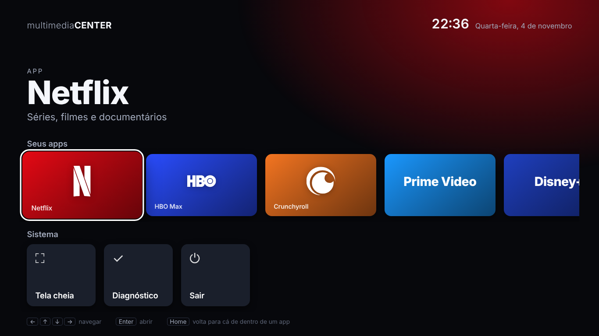

# multimediaCENTER

Um centro multimídia em tela cheia, com cara de TV, para dar nova vida a laptops antigos com Windows. Ele abre serviços de streaming como Netflix, Max (HBO), Crunchyroll, Prime Video e Disney+ e é controlado pelas setas, Enter e Voltar.

O app roda dentro do **Google Chrome**, que já traz o Widevine, o DRM que esses serviços exigem. Ele usa um perfil do Chrome só dele, então não mexe no seu Chrome do dia a dia, e os logins nos serviços ficam salvos nesse perfil.

## Situação atual (passo 2 de 4)

- **Tela inicial estilo TV**, com uma fileira de apps (Netflix, HBO Max, Crunchyroll, Prime Video, Disney+, YouTube, Spotify e Twitch), cada um com a sua logo e uma fileira de sistema (tela cheia, diagnóstico e sair).
- O app em foco aparece em destaque, e o fundo ganha a cor dele.
- A tela lembra o último app usado ao voltar.
- **Diagnóstico** confere se está no Google Chrome e se o Widevine está disponível.

Atalhos: as setas navegam, **Enter** abre, **Home** ou **F1** voltam para a tela inicial de dentro de qualquer app, e **F11** liga e desliga a tela cheia.

## Como usar no Windows

Você só precisa ter o [Google Chrome](https://www.google.com/chrome/) instalado.

1. Baixe o projeto (botão **Code → Download ZIP** no GitHub) e extraia numa pasta fixa, por exemplo `C:\multimediaCENTER`.
2. **Só na primeira vez:** dê dois cliques em `Configurar.bat` e siga as instruções da tela. Elas pedem para ativar o "Modo do desenvolvedor" e carregar a pasta `extensao` com "Carregar sem compactação".
3. Depois, é só abrir o `MultimediaCenter.bat`. Dá para criar um atalho dele na área de trabalho.

Se você mudar a pasta do projeto de lugar, rode o `Configurar.bat` de novo.

## Como funciona

- `extensao/`: uma extensão do Chrome com a tela inicial (`inicio.html`), a lista de apps (`servicos.js`), o diagnóstico (`diagnostico.html`) e o atalho que volta para o início (`atalhos.js` e `fundo.js`). A chave fixa no `manifest.json` garante que o endereço da extensão seja sempre o mesmo.
- `MultimediaCenter.bat`: acha o Chrome, abre o perfil do multimediaCENTER e mostra a tela inicial em tela cheia, sem barra de endereço.
- `Configurar.bat`: abre a página de extensões nesse perfil para carregar a extensão.

## Logos

As logos em `extensao/logos/` vêm do [Simple Icons](https://simpleicons.org/) (versão 16.36.0, licença CC0) e são marcas registradas dos seus donos, usadas só para identificar cada serviço. O Simple Icons não tem logos do Prime Video e do Disney+, então esses dois cartões mostram o nome. Para trocar ou adicionar uma logo, coloque um arquivo SVG ou PNG branco em `extensao/logos/` e aponte o campo `logo` do serviço em `extensao/servicos.js` para ele.

## Limitações conhecidas

- A qualidade máxima depende de cada serviço. A Netflix, por exemplo, costuma limitar o Chrome a 1080p.
- O Chrome mostra um aviso sobre extensões no modo do desenvolvedor de vez em quando. É só fechar.

## Plano

1. ✅ Base no Google Chrome com tela de diagnóstico
2. ✅ Tela inicial estilo TV com navegação por setas
3. Abrir os serviços em tela cheia e voltar ao início
4. Modo leve, iniciar junto com o Windows e instalador
